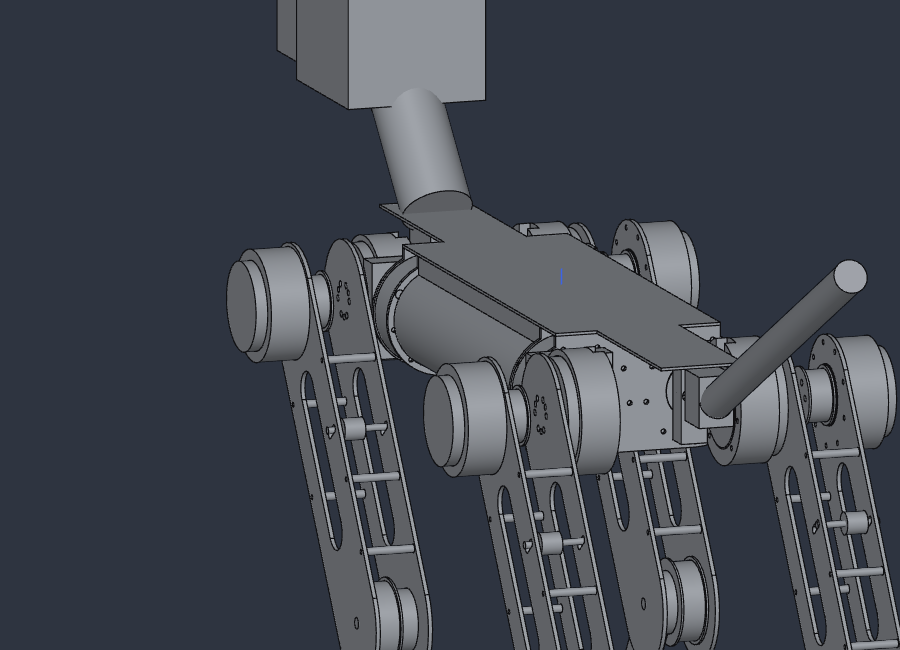
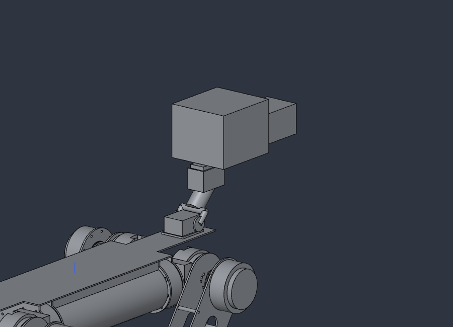

# RoboPuppy

A Labrador-sized quadruped robot dog, built from 3D-printed and laser-cut parts and designed in SolidCraft.


## Status
First detailed design pass. The whole robot is modelled as an articulated assembly: torso, four legs, neck, head and tail. Fasteners, servo mounts and some drive details are still missing, and nothing has been built yet.

## Design targets
- Torso about 60 cm long, with the rest scaled to a dog of that size
- 16 actuated axes: 3 per leg, 2 for the head (neck tilt and head pan), 2 for the tail
- Dynamic trotting
- About 11 kg all-up
- Central torso bay for battery and electronics

## Actuators
| Joints | Actuator |
|---|---|
| 12 leg joints | RobStride 01 quasi-direct-drive (17 N·m peak, 380 g, CAN, 36 V) |
| Neck tilt, head pan, tail wag, tail lift | Feetech STS-family serial bus servos |

## Design


- **Legs:** an abduction actuator on the torso, a hip-pitch actuator in a printed carrier, and a knee actuator at the hip that drives the knee through a 1.5:1 HTD 5M belt between two laser-cut thigh plates. The shank, knee pulley and foot core are one printed part.
- **Torso:** each pair of abduction actuators is clamped between two aluminium plates. A printed belly pan forms the central bay and an aluminium deck closes the top.
- **Neck and head:** a tilt servo on the deck nods the whole neck; a pan servo at the top of the neck turns a hollow printed head with a camera behind each eye.
- **Tail:** a wag servo and a lift servo at the tail root move a flexible TPU tail.



| Measure | Value |
|---|---|
| Torso structure length | 612 mm |
| Hip spacing, front to rear | 420 mm |
| Width | 323 mm |
| Thigh / shank | 242 mm / 242 mm |
| Back height, standing | about 470 mm |
| Estimated mass | 10.5–11.2 kg |

## Repository
- `cad/actuators/` – RobStride 01 reference model
- `cad/leg/` – detailed leg
- `cad/robot/` – whole-robot model and renders
- `cad/scripts/` – generator scripts

The models are generated from scripts. To rebuild after changing a dimension:

```
node cad/scripts/gen_leg.js
solidcraft-cli run cad/leg/build/leg_detailed.json --save cad/leg/leg_detailed.sc

node cad/scripts/gen_robot.js
solidcraft-cli run cad/robot/build/robot.json --save cad/robot/robot.sc
```

Production files (cut files, print files, STEP) are not stored in the repository. They will be exported once the design is complete.

## Licence
See [LICENSE](LICENSE).
