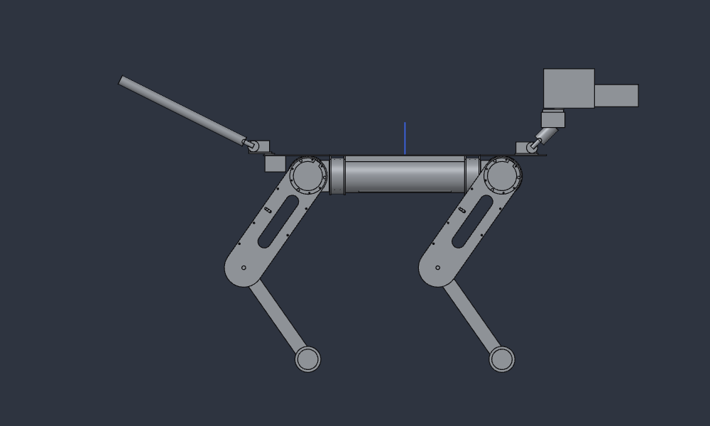
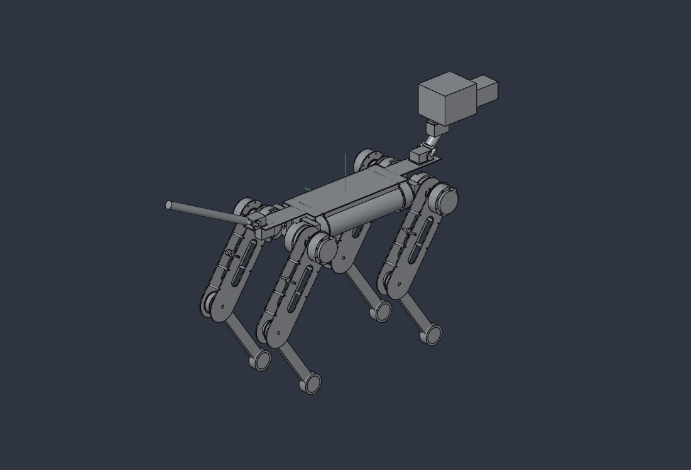
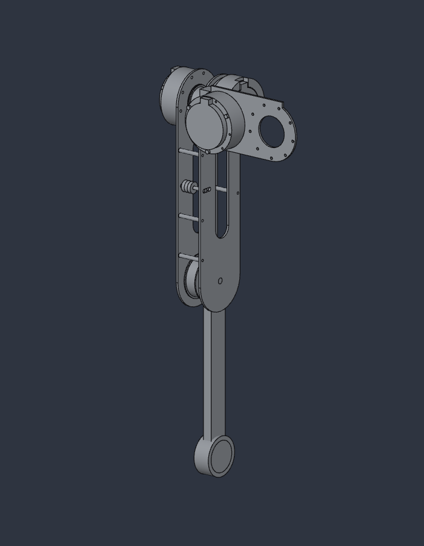

# RoboPuppy

A Labrador-sized quadruped robot dog, built from 3D-printed and laser-cut parts, modelled in SolidCraft.



## Status
First detailed design pass. The whole robot is modelled as an articulated assembly: torso, four legs, neck, head and tail. Two knee drives are modelled side by side: a belt drive and a crank-and-pushrod linkage. Every part is its own file, linked into the assemblies, so the bill of materials comes straight from the model. Fasteners, servo mounts and some drive details are still missing, and nothing has been built yet.

The leg actuators are now RobStride 02s, modelled from the official STEP file. A simplified motion rig of the whole robot is used to find the joint ranges by dragging the legs. The battery is changing from 10S to 13S2P; the model's battery space has not been resized yet. The pictures below still show the earlier RobStride 01 model.

## Design targets
- Torso about 60 cm long, with the rest scaled to a dog of that size
- 16 actuated axes: 3 per leg, 2 for the head (neck tilt and head pan), 2 for the tail
- Dynamic trotting
- About 11 kg all-up
- Central torso bay for battery and electronics

## Actuators
| Joints | Actuator |
|---|---|
| 12 leg joints | RobStride 02 quasi-direct-drive (17 N·m peak, about 405 g, CAN, 48 V) |
| Neck tilt, head pan, tail wag, tail lift | Feetech STS-family serial bus servos |

Power comes from a 13S2P Li-ion pack: 26 × 21700 cells, 46.8 V nominal, 468 Wh, about 2.1 kg. That gives an estimated 2–3 hours of trotting. See [docs/robstride_comparison.md](docs/robstride_comparison.md) for the actuator comparison and [docs/battery.md](docs/battery.md) for the battery sizing.

## Design


- **Legs:** an abduction actuator on the torso, a hip-pitch actuator in a printed carrier, and a knee actuator at the hip, coaxial with the hip pitch. Two ways of driving the knee are modelled:
  - **Belt:** a 1.5:1 HTD 5M belt between two laser-cut thigh plates. A printed horseshoe spacer clamps the plates together around the hip. The shank, knee pulley and foot core are one printed part.
  - **Linkage:** a crank on the knee actuator and a pushrod with rod ends down the back of the thigh, driving a lever on the shank (about 1.4:1 standing, knee fold 45–140°). The thigh plates taper and sit closer together. The robot is 30 mm narrower and about 0.7 kg lighter.
- **Shared parts:** left and right legs are mirror images built from the same parts. Each fabricated part is symmetric, or works turned over, so one print or cut file serves both sides. One hip carrier design fits all four hips.
- **Torso:** each pair of abduction actuators is clamped between two aluminium plates. A printed belly pan forms the central bay and an aluminium deck closes the top. The actuators' power plugs pass through slots in the deck and notches in the belly pan. The deck runs on as a spine to the neck and tail, stiffened by a bent aluminium rib under each end.
- **Neck and head:** a tilt servo on the deck nods the whole neck; a pan servo at the top of the neck turns a hollow printed head with a camera behind each eye.
- **Tail:** a wag servo and a lift servo at the tail root move a flexible TPU tail.



| Measure | Value |
|---|---|
| Torso structure length | 612 mm |
| Hip spacing, front to rear | 420 mm |
| Width | 333 mm (belt knee), 303 mm (linkage knee) |
| Thigh / shank | 242 mm / 242 mm |
| Back height, standing | about 470 mm |
| Estimated mass | 10.8–11.5 kg |

The bills of materials are in [cad/robot/bom.csv](cad/robot/bom.csv) (belt knee: 27 items, 20 of them fabricated) and [cad/robot/bom_linkage.csv](cad/robot/bom_linkage.csv) (linkage knee: 27 items).

## Repository
- `cad/parts/` – one design file per unique part, purchased parts included
- `cad/leg/` – single-leg assemblies (`leg.sc` belt, `leg_linkage.sc` linkage)
- `cad/robot/` – whole-robot assemblies (`robot.sc`, `robot_linkage.sc`), the motion rig (`motion_rig.sc`), renders and bills of materials
- `cad/scripts/` – generators: `dims.js` (all dimensions), `parts.js` (the parts), `assemblies.js` (legs and robots, both knee variants), `rig.js` (motion rig), `build.js` (runs them)
- `cad/actuators/` – older RobStride 01 reference model (the assemblies use `cad/parts/robstride02.sc`)
- `docs/` – design notes: actuator comparison and battery sizing
- `.claude/skills/cad-modelling/` – the modelling conventions the generators follow

The models are generated from scripts. Every feature comes from a fully constrained sketch, and all dimensions live in one table. To rebuild after changing a dimension (needs SolidCraft installed), run from the repository root:

```
node cad/scripts/build.js all                          # every part, then both legs and both robots
node cad/scripts/build.js parts shank                  # one part
node cad/scripts/build.js rig                          # motion rig: simplified legs you can drag in SolidCraft
node cad/scripts/build.js symmetry                     # check that parts used on both sides equal their mirror image
node cad/scripts/build.js check robot                  # clash check of the saved robot (add --app for renders)
node cad/scripts/build.js pose HipAbduction -45 45     # clash check with all four abduction joints driven
node cad/scripts/build.js pose robot_linkage Knee -45 -140   # the same on the linkage robot
```

Without `--app` the scripts use `solidcraft-cli`. With `--app` they run in the open SolidCraft desktop app through its local control channel, which needs "Let AI agents connect" turned on in the app. Use `--app` when Windows will not start the command-line tool, for example when Smart App Control blocks unsigned programs.

The motion rig (`cad/robot/motion_rig.sc`) has simplified legs with the real link lengths, joint positions and joint limits, laid out so that SolidCraft can drag them with the mouse. Turn contact off (Disable Contact) before dragging: live collision checking is too slow on this model. The link lengths (`lt`, `ls`, `lk_a`, `lk_b`, `lk_c`) can be changed in the app's parameter table.

Production files (cut files, print files, STEP) are not stored in the repository. They will be exported once the design is complete.

## Licence
See [LICENSE](LICENSE).
