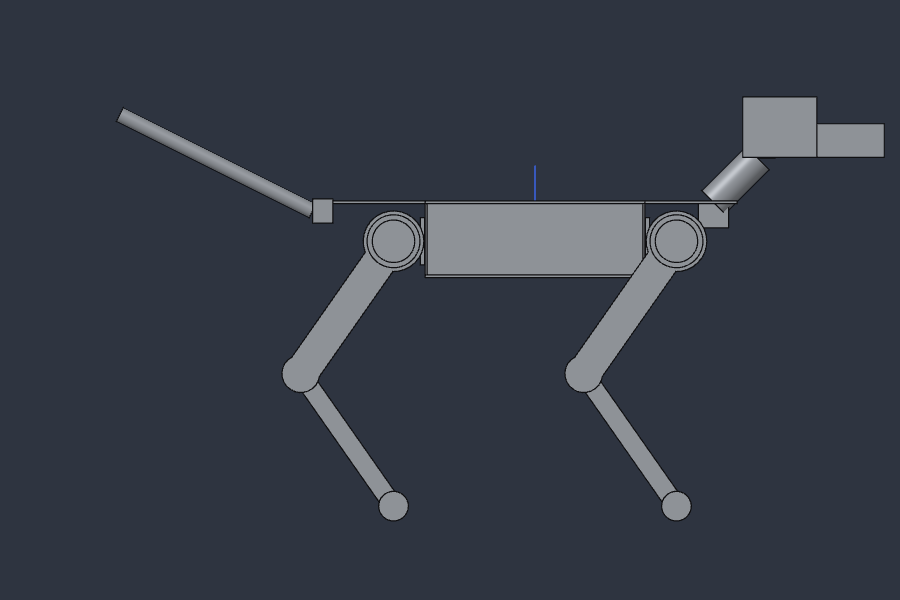

# RoboPuppy

A Labrador-sized quadruped robot dog, built from 3D-printed and laser-cut parts and designed in SolidCraft.



## Status
Concept stage. The actuators are chosen and a whole-robot block-out confirms the proportions. No parts are ready to manufacture yet.

## Design targets
- Torso about 60 cm long, with the rest scaled to a dog of that size
- 16 actuated axes: 3 per leg, 2 for the head (neck tilt and head pan), 2 for the tail
- Dynamic trotting
- About 11 kg all-up
- Central torso bay for battery and electronics

## Actuators
| Joints | Actuator |
|---|---|
| 12 leg joints | RobStride 01 quasi-direct-drive (17 N·m peak, 380 g, CAN, 36 V) |
| Head and tail | serial bus servos (to be finalised) |

Each leg has an abduction actuator on the torso, a hip-pitch actuator in a carrier, and a knee actuator mounted at the hip that drives the knee through a 1.5:1 belt inside the thigh.

## Block-out dimensions
| Measure | Value |
|---|---|
| Torso structure length | 600 mm |
| Hip spacing, front to rear | 420 mm |
| Width | 285 mm |
| Thigh / shank | 240 mm / 240 mm |
| Back height, standing | about 475 mm |
| Top of head | about 630 mm |

## Repository
- `cad/actuators/` – RobStride 01 reference model
- `cad/leg/` – single-leg concept
- `cad/robot/` – whole-robot block-out and renders
- `cad/scripts/` – script that generates the block-out

To rebuild the block-out after changing the layout numbers in the script:

```
node cad/scripts/gen_blockout.js
solidcraft-cli run cad/robot/build/robot_blockout_all.json --save cad/robot/robot_blockout.sc
```

## Licence
See [LICENSE](LICENSE).
